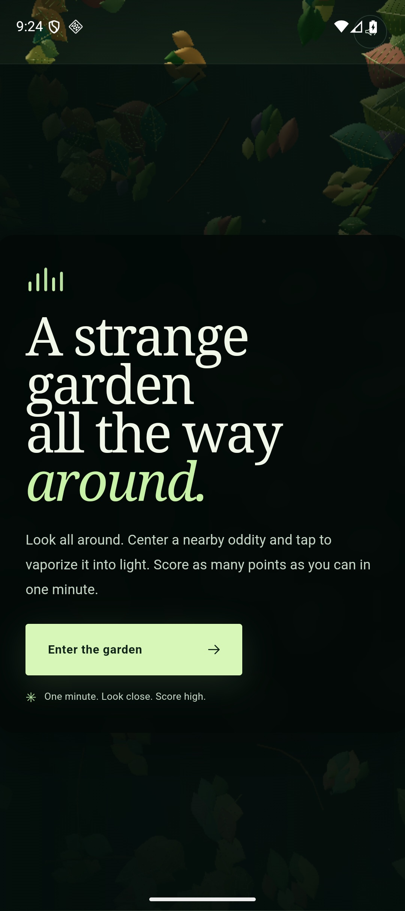
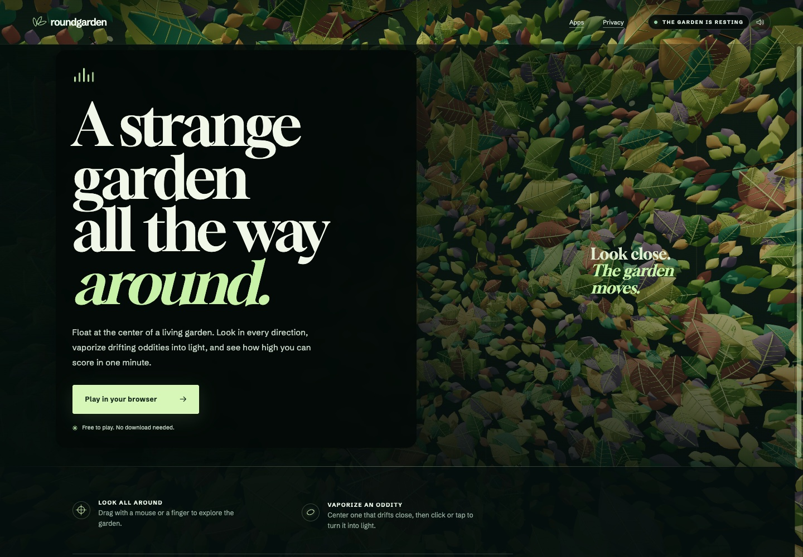

# Roundgarden for Android

The Android app runs the existing Three.js game in a local WebView and packages
the game files in the APK. Its Android-only render profile lowers scene density
and disables shadows and antialiasing to keep the 3D scene responsive. Gameplay
stays shared with the browser version, including 360° touch look,
centered-target vaporization, one-minute rounds, scoring, pause/resume, and the
on-device personal best. The Android profile is enabled only by the app's
`?android-app=1` entry; web and Apple apps do not use it.

## Build

Use JDK 17, Android SDK 37.2, and Node 24.22.2. Run from this directory:

```sh
./gradlew assembleDebug
```

Gradle builds the web game with relative asset URLs and copies it into the APK.
Run `npm ci` from the repository root once to install web dependencies.

## Test

Android lint and an emulator smoke test verify the packaged entry screen and
that the Three.js renderer completes its initial frame:

```sh
./gradlew lintDebug connectedDebugAndroidTest
```

GitHub Actions runs these checks on an Android emulator and uploads the debug
APK. The unit-test task currently has no JVM test sources.

## Port map

| Android responsibility | Implementation |
| --- | --- |
| Activity lifecycle and local asset serving | `app/src/main/java/io/adambailey/roundgarden/MainActivity.java` |
| Packaged game, camera, aiming, scoring, rounds, and local best | Shared `../web/src/main.js` |
| Android entry layout and render profile | `../web/src/main.js` and `../web/src/style.css`, enabled by `?android-app=1` |
| Web build and APK asset packaging | `app/build.gradle.kts` |
| Emulator behavior check and CI | `app/src/androidTest/` and `../../.github/workflows/android.yml` |

This WebView port is the user-approved direction for the current slice. Issue
#19's native Compose and renderer-independent implementation remain open.

## Screenshots

The phone capture shows the packaged Android app on an Android 16 emulator; the
desktop capture shows the shared web game used as its visual reference.





Manual checks still needed: touch dragging and aiming, target scoring and
vaporization, a complete round, background pause/resume, TalkBack, reduced
motion, tablet layouts, and physical Android devices.

## Platform behavior

Drag to look and tap to activate a centered reachable oddity. The WebView's
local storage keeps the personal best. Android pauses the round when the
activity leaves the foreground; system navigation bars remain visible.
