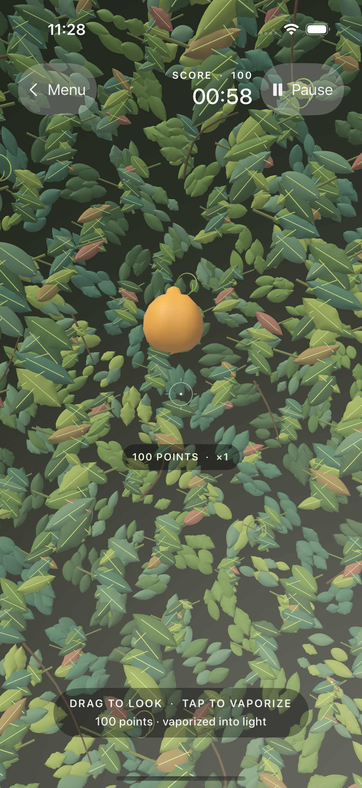
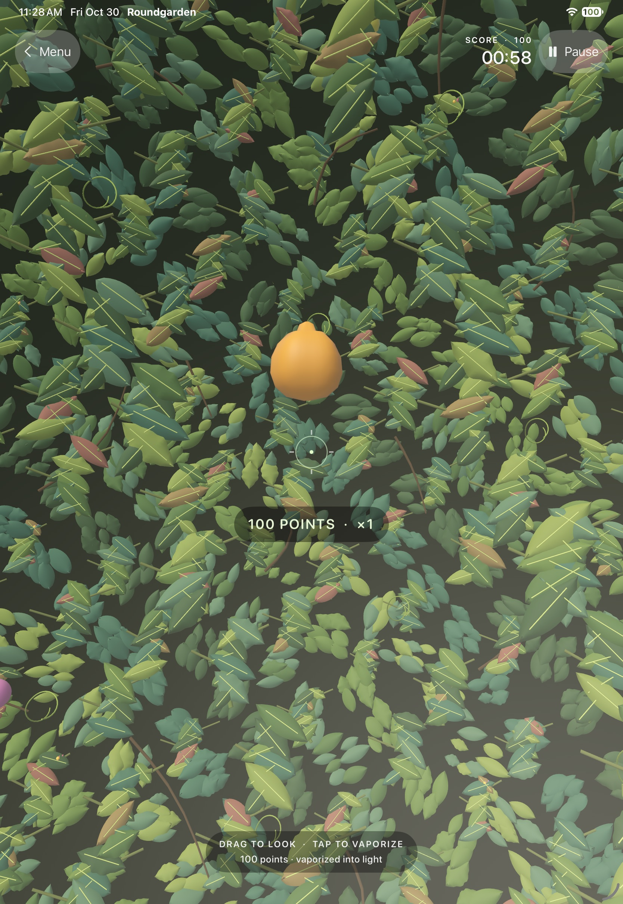

# iOS app

The native iOS app lives in `Roundgarden.xcodeproj`. It uses SwiftUI for the launch menu and controls, RealityKit for the garden scene, and `packages/game-core` for the renderer-independent round rules, aim selection, and starter oddity catalog. The app targets iOS 18 and supports iPhone and iPad.

## Open and build

Open `Roundgarden.xcodeproj` in Xcode, select the `Roundgarden` scheme, and run on an iOS Simulator. The project is generated from `project.yml` with XcodeGen; regenerate it after changing the project specification:

```sh
xcodegen --spec apps/ios/project.yml --project apps/ios
```

The local unsigned simulator build command is:

```sh
xcodebuild -project apps/ios/Roundgarden.xcodeproj \
  -scheme Roundgarden \
  -destination 'generic/platform=iOS Simulator' \
  CODE_SIGNING_ALLOWED=NO build
```

From the menu, choose **Enter the garden**, then start a 60-second round. Drag to look around; tap to vaporize the oddity centered by the reticle. The score uses the web game's 100/250/500 values and 1×/2×/3× proximity bands. Pause freezes time and motion; leaving a round returns to Ready; replay starts from zero. Completed scores update the device's personal best. Produce-only aim selection ignores decorative geometry.

Run core and touch-flow tests:

```sh
swift test --package-path packages/game-core
xcodebuild test -project apps/ios/Roundgarden.xcodeproj \
  -scheme Roundgarden \
  -destination 'platform=iOS Simulator,name=iPhone 17 Pro' \
  CODE_SIGNING_ALLOWED=NO
```

## Simulator captures

Captured from the playable UI flow on iPhone 17 Pro and iPad Pro 11-inch simulators:




