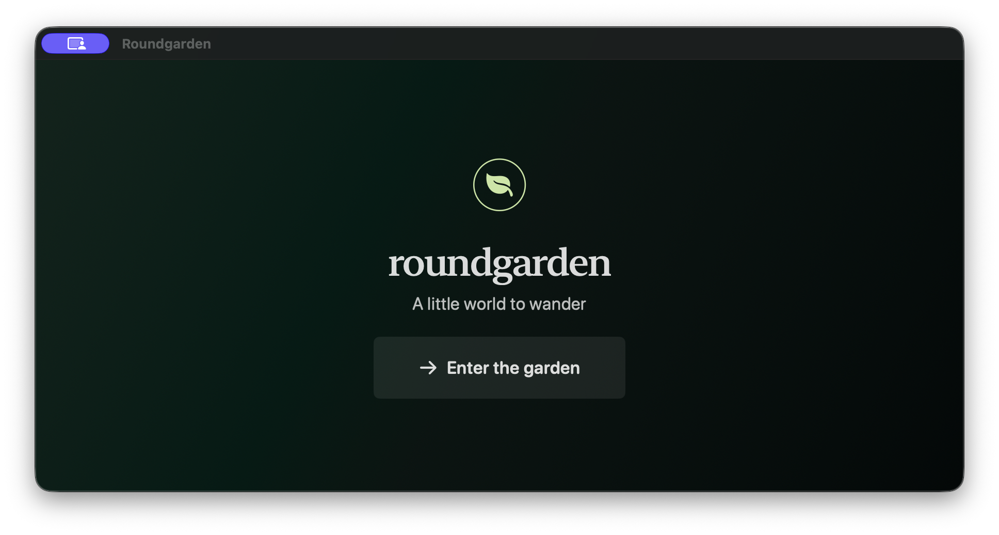

# Roundgarden for macOS

The macOS app shares its SwiftUI and RealityKit game view with iOS and uses
`RoundgardenCore` for the game rules and content.



Generate the Xcode project with XcodeGen, then build or run the UI test:

```sh
xcodegen generate --spec apps/macos/project.yml --project apps/macos
xcodebuild -project apps/macos/RoundgardenMac.xcodeproj -scheme RoundgardenMac \
  -destination 'platform=macOS' CODE_SIGNING_ALLOWED=NO build
xcodebuild -project apps/macos/RoundgardenMac.xcodeproj -scheme RoundgardenMac \
  -destination 'platform=macOS' CODE_SIGNING_ALLOWED=YES CODE_SIGN_IDENTITY=- test
```

Use the pointer to drag the garden view or click a centered oddity. Arrow keys
turn the view after it receives focus, and Escape toggles pause and resume.
