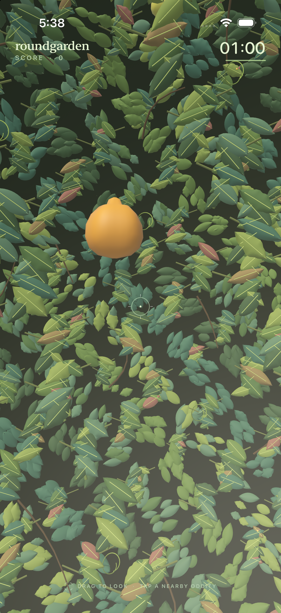

# RealityKit renderer spike

Disposable SwiftUI + RealityKit prototype for the Phase 2 renderer decision. The same source builds for iOS and macOS. It exercises a full-sphere perspective camera, procedural radial foliage and produce, directional and point lighting, and drag-to-look input. Tap/click is a temporary interaction stand-in; production target selection and scoring remain out of scope.

## Build and run

Open `RealityKitSpike.xcodeproj` in Xcode and select `RealityKitSpike_iOS` for an iPhone/iPad simulator or `RealityKitSpike_macOS` for Mac. The deployment targets are iOS 18 and macOS 15, matching the provisional ADR proposal. The project is generated from `project.yml` with XcodeGen.

## Initial results

- The shared scene compiles for macOS and iOS Simulator with the proposed deployment targets.
- The app launches on an iPhone 17 Pro simulator (iOS 26.5). Drag gestures rotate the camera; a tap increments the temporary light counter.
- The screenshot shows the procedural foliage field and moving produce on iPhone 17 Pro Simulator.



## Limits and next checks

The 2026-10-30 pass adds three foliage silhouettes, a green-weighted palette, a continuous backdrop, and viewport-aware layout. The garden fills the iPhone and iPad displays; the Mac version respects the window title bar. These procedural forms still do not establish final visual parity. Target selection, shadow/transparency quality, and frame rate on representative iPhone/iPad and Mac hardware still need validation before adopting RealityKit or changing the proposed renderer decision.

## Build and format checks

Format the Swift sources and check them with the same formatter used in native CI:

```sh
xcrun swift-format format --in-place spikes/RealityKitSpike/RealityKitSpike/*.swift
xcrun swift-format lint --strict spikes/RealityKitSpike/RealityKitSpike/*.swift
```

The native workflow builds both targets with code signing disabled. Simulator and generic macOS builds do not require signing. To install on a physical iPhone or iPad, select a local Apple development team and provisioning profile in Xcode.

## Phase 2 validation — 2026-10-30

- `xcodebuild` passed for both `RealityKitSpike_iOS` on the iPhone 17 Pro simulator (iOS 26.5) and `RealityKitSpike_macOS` (macOS 27 SDK, macOS 15 deployment target).
- The iPhone 17 Pro simulator launched the app and rendered the garden, HUD, reticle, and produce across the full display. Adding generated launch-screen metadata removed the legacy 2:3 iPhone viewport; the iPad Pro 11-inch simulator (iOS 27.0) also fills its display.
- The native scene now uses three leaf silhouettes, a green-weighted foliage palette, a continuous dark garden backdrop, and width-scaled HUD/reticle sizing. Safe-area extension is iOS-only so the Mac HUD remains below its title bar.
- The local macOS app was launched and reviewed in a resizable window. Current captures: [iPhone 17 Pro](screenshots/iphone-17-pro.png), [iPad Pro 11-inch](screenshots/ipad-pro-11-inch.png), and [Mac window](screenshots/macos-window.png).
- Still captures do not verify camera response, produce approach/scale over time, shadow quality, or transparency behavior. The spike has no target picking yet, so occlusion-safe selection is not established.
- No frame-time or memory measurements were collected on physical target hardware. Simulator builds and launch do not satisfy the device-performance check.

**Result:** the composition and foliage-fidelity pass is implemented and reviewed across iPhone, iPad, and Mac windows. Native CI now includes Swift formatting and iOS/macOS builds. The first Phase 2 validation checklist item remains open until platform input, motion, lighting, transparency, occlusion, and physical-device performance are measured.
